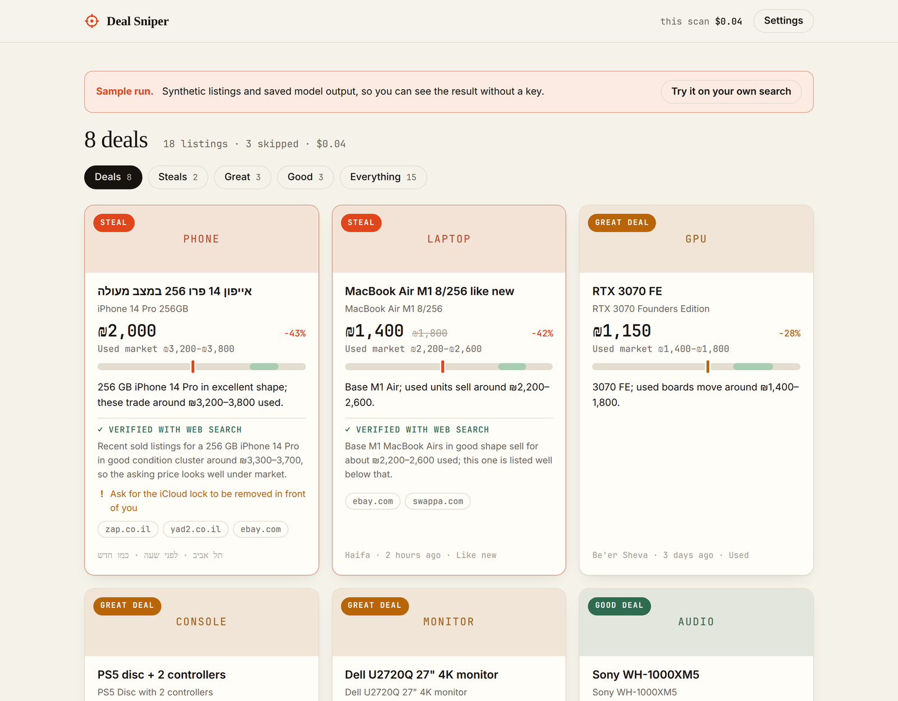

# Deal Sniper

Find underpriced electronics on Facebook Marketplace. A bookmarklet reads the search you have open, Claude estimates what each item really sells for used, the best candidates are double-checked with live web search, and you get a ranked list of what is worth a message.

It runs entirely in your browser with your own Anthropic API key. No server, no extension, no account.

**[Try the sample run →](https://catnotbat.github.io/deal-sniper/app.html?demo)** &nbsp;·&nbsp; **[Install →](https://catnotbat.github.io/deal-sniper/#install)**



## How it works

```
facebook.com/marketplace            your browser, github.io page                api.anthropic.com
┌──────────────────────┐  #fragment ┌───────────────────────────────┐   HTTPS   ┌──────────────────────┐
│ bookmarklet          │ ─────────▶ │ app.html                      │ ────────▶ │ Claude Haiku 5.5     │
│ scroll + read cards  │  deflate + │ 1. screen every listing       │           │ structured output    │
│ (shadow-DOM panel)   │  base64url │ 2. verify the top 5           │ ────────▶ │ Claude Sonnet 5.5    │
└──────────────────────┘            │ 3. rank, show cost            │           │ + web search         │
                                    └───────────────────────────────┘           └──────────────────────┘
```

1. **Scrape.** The bookmarklet finds listing cards on the Marketplace page, auto-scrolls to load more, and parses title, price (any currency, including struck-through "was" prices), location and photo. Its panel lives in a shadow root, so Facebook's CSS can't touch it.
2. **Hand off.** Listings are JSON-encoded, compressed with `CompressionStream("deflate-raw")` and placed in the URL **fragment** of the results page. Fragments are never sent to a server; the page removes it from the address bar as soon as it has read it.
3. **Screen.** Claude Haiku 5.5 reads listings in batches of 40 and returns, as [structured output](https://docs.claude.com/en/docs/build-with-claude/structured-outputs) validated by a zod schema, the exact product (Hebrew and English titles alike) and a used-market price range in the listing's own currency. It doesn't decide what counts as a deal.
4. **Score.** The verdict is computed in plain code from asking price ÷ market midpoint: ≤ 60% is a *steal*, ≤ 75% *great*, ≤ 85% *good*. A low-confidence estimate can't produce a steal. This keeps the ranking deterministic and testable.
5. **Verify.** The top five go to Claude Sonnet 5.5 with the web search tool, which looks up recent second-hand prices, revises the range, lists red flags and links its sources.
6. **Show the bill.** Token usage and searches from each response are priced and shown live. A scan of about 150 listings typically costs a few cents.

## Use it

1. Open the [install page](https://catnotbat.github.io/deal-sniper/#install) and drag **Deal Sniper** to your bookmarks bar.
2. Open a Facebook Marketplace search (for example "macbook" near you) and click the bookmark.
3. Let it auto-scroll, or scroll yourself; then press **Find deals**.
4. Paste an Anthropic API key the first time. Create a dedicated key with a low spend limit in the [Anthropic Console](https://console.anthropic.com/settings/keys).

### About the API key

The results page calls `api.anthropic.com` directly from your browser (`dangerouslyAllowBrowser: true` in the SDK). That is only reasonable because the key is **yours** and stays on **your** device:

- it is kept in `localStorage` for this site (or `sessionStorage` if you untick "remember") and sent only to `api.anthropic.com`;
- the page's Content-Security-Policy allows network requests to that host only, and all listing text is rendered with `textContent`, never as HTML;
- the bookmarklet never sees the key.

## Develop

```bash
npm install
npm test          # vitest: parsing, handoff, scoring, pipeline (with a fake client), rendering
npm run dev       # build + serve dist/ on http://localhost:8000 with rebuild on change
npm run build     # static site in dist/
```

When served from your own origin, the install page writes that origin into the bookmarklet, so a fork works without any configuration. GitHub Pages deploys from `main` via `.github/workflows/pages.yml`.

```
src/core/        price & card parsing, handoff codec, prompts, pipeline, scoring, cost
src/bookmarklet/ scraper + shadow-DOM panel (bundled into a javascript: URL)
src/app/         results page and install page
site/            static HTML, CSS and the sample run (demo.json)
scripts/         build and sample-data generation
```

## History

The first version (June 2026, still in the git history) was a Cloudflare Worker that priced listings against eBay's Browse API. eBay's US listings were a poor proxy for local second-hand prices, and the setup needed four secrets and a deployed backend. This version drops the backend in favour of Claude estimates plus web-search verification, which work in the listing's own market and currency and need nothing but an API key.

## Disclaimer

An independent hobby project, not affiliated with Meta or Anthropic. It reads only the page you have open, at the pace you scroll, but automated collection may still conflict with Facebook's terms of service; use it on your own searches and at your own risk. Price estimates can be wrong. Always check the item in person.

## License

[MIT](LICENSE)
